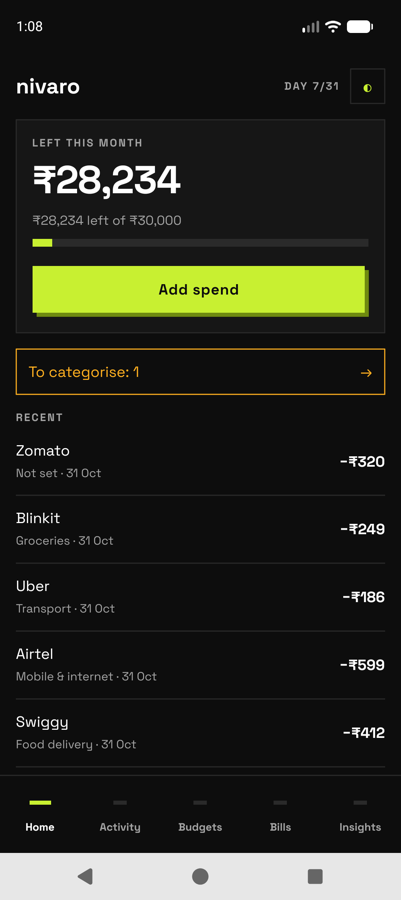
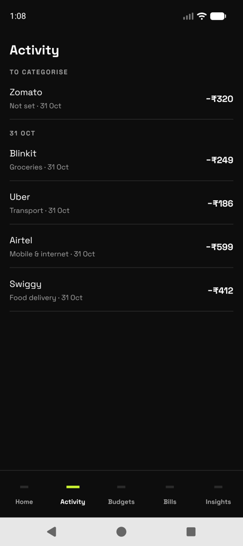
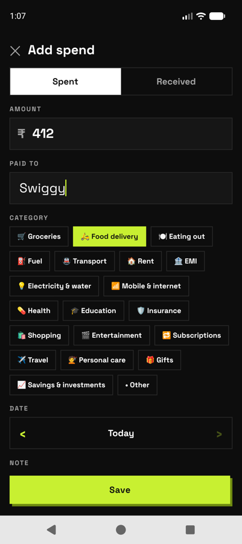
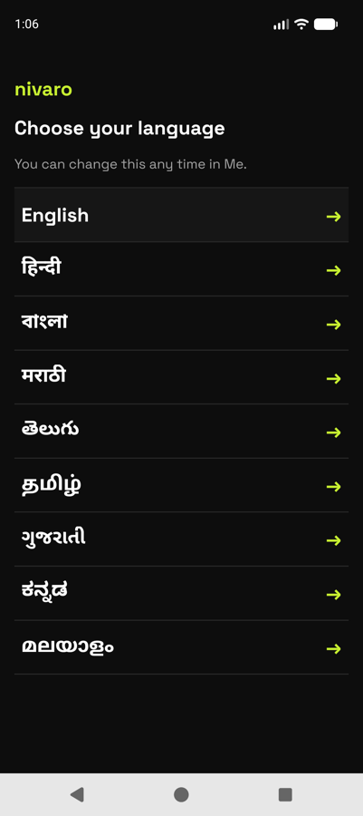
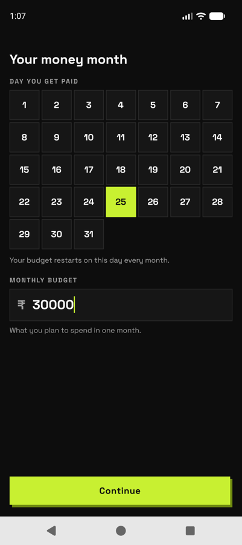
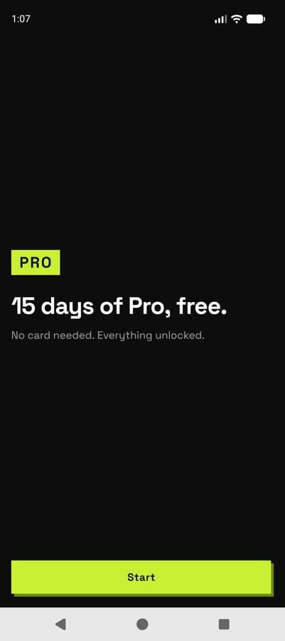
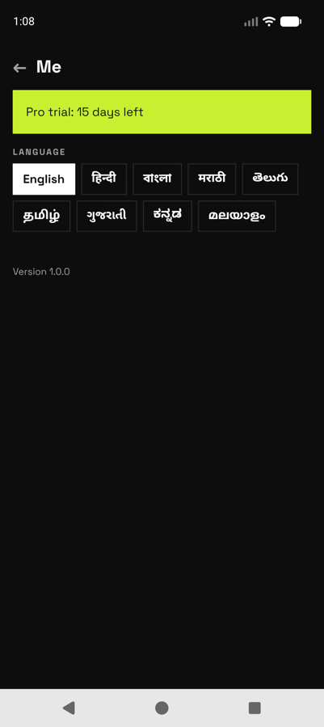
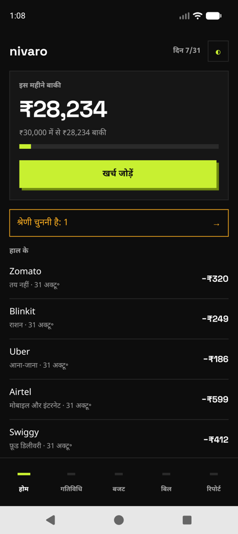
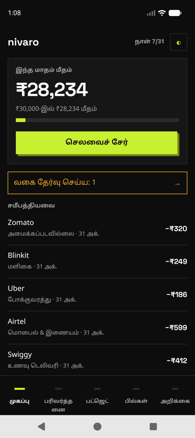

# Nivaro

A budget tracker for India. You set a monthly budget and the day you get paid, log what you spend, and Nivaro shows how much is left for the month.

The goal is automatic tracking: purchases get logged from the bank SMS and app notifications you already receive, so you rarely type anything in. That part is not built yet. Right now spends are added by hand.

Android and iPhone, built with React Native and Expo. Data stays on the phone.

## Screenshots

| Home | Activity | Add a spend |
|---|---|---|
|  |  |  |

| Choose language | Payday and budget | Free trial |
|---|---|---|
|  |  |  |

| Me | Home in Hindi | Home in Tamil |
|---|---|---|
|  |  |  |

## What works today

- First launch asks for your language, the day you get paid, and your monthly budget.
- The budget month starts on payday, not the 1st. A payday of 31 falls back to the last day in shorter months.
- Home shows what is left this month, a progress bar, and your recent spends.
- Add, edit and delete spends. Each one has an amount, who you paid, a category, a date and an optional note.
- Spends without a category are flagged so you can sort them later.
- Nine languages: English, Hindi, Bengali, Marathi, Telugu, Tamil, Gujarati, Kannada and Malayalam. You can switch at any time from the Me screen.
- Amounts use Indian number formatting (₹1,25,000).
- A 15-day free trial of Pro starts after setup. No card needed.

Budgets, Bills and Insights tabs are placeholders for now.

## Planned

In order:

1. **Automatic capture.** On Android, read bank SMS and notifications from UPI apps, bank apps and Gmail. On iPhone, use a Shortcuts automation. Remember the category for each shop.
2. **Budgets and bills.** Per-category limits, warnings before you overspend, "safe to spend today", bills, EMIs and subscriptions with reminders.
3. **Reports.** Spending by category, shop, card and UPI account. Search and CSV export.
4. **Accounts and Pro.** Optional sign-in with Google or Apple for backup, and the paid Pro plan.
5. **Sharing.** Split a bill with friends and share a budget with a partner.
6. **Store release** on Google Play and the App Store.

## Running it locally

You need Node 24 and, for Android, Android Studio with an emulator. iPhone builds need a Mac with Xcode.

```bash
npm install
npx expo run:android
```

The first native build takes a few minutes. After that, `npx expo start` reloads changes on the device.

## Tests

```bash
npm test
npm run typecheck
```

The tests cover money formatting and parsing, payday cycles, the trial clock, the on-device database, onboarding steps and the translation files.

## Project layout

```
src/app/        screens (Expo Router)
src/domain/     money, payday cycle and trial logic
src/db/         SQLite schema and data access
src/features/   screen logic: onboarding, home, settings, spends
src/i18n/       language files
src/theme/      colours, spacing and fonts
src/ui/         shared components
tests/          Jest tests
```

## Notes

- The translations are first drafts. Each language file still needs a check by a native speaker.
- iPhone has not been tested on a device yet.
